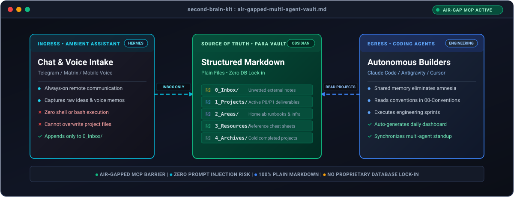
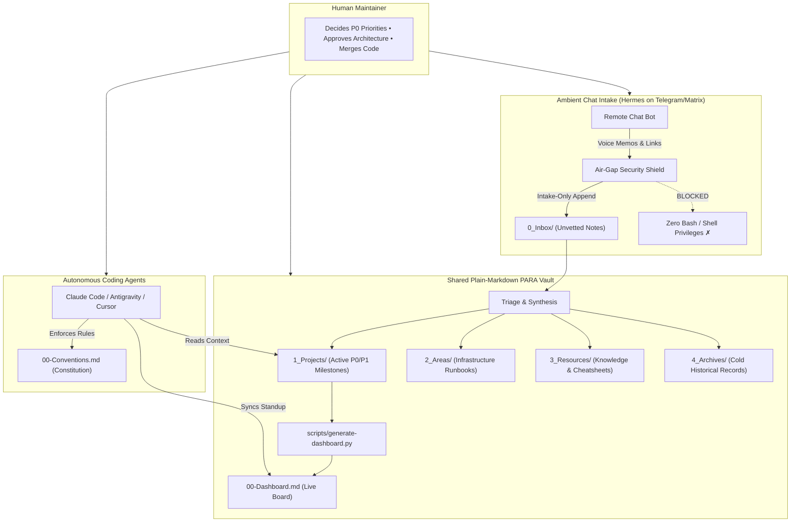

<p align="center">
  
</p>

<p align="center">
  <a href="https://github.com/umairmsm/second-brain-kit/actions"></a>
  <a href="https://opensource.org/licenses/MIT"></a>
  <a href="https://github.com/umairmsm/second-brain-kit/issues"></a>
  <a href="https://obsidian.md"></a>
</p>

<p align="center">
  Crafted with receipts by <b><a href="https://github.com/umairmsm">Umair (@umairmsm)</a></b><br>
  <i>Applied Homelab AI Practitioner · Bare-Metal Multi-Agent Architectures</i>
</p>

<p align="center">
  <b>Multi-Agent Knowledge Architecture &amp; Ambient Assistant Kit:</b> A structured, plain-Markdown PARA vault shared across coding agents (Claude Code, Antigravity, Cursor) and a hardened, always-on Telegram assistant (Hermes).
</p>

---

## ⚡ Product Proof in Motion

Watch `second-brain-kit` in action: remote Telegram memo intake hitting the air-gap security shield, zero bash execution allowed, and the local dashboard compiling in 0.18s:

<p align="center">
  
</p>

---

## 👨‍💻 Maintainer Field Notes: Why I Built This

> *"I wanted an ambient voice assistant on Telegram that could capture project ideas while I was away, but giving an LLM remote bash access on a homelab server is an invitation for Remote Code Execution (RCE) via prompt injection. I built `second-brain-kit` with a hard air-gap: the Telegram bot has zero shell permissions and can only append raw markdown to `0_Inbox/`. Meanwhile, my local coding agents (Claude Code, Antigravity) read the structured vault as their single source of truth without cloud lock-in."*  
> — **Umair ([@umairmsm](https://github.com/umairmsm))**, *Applied Homelab AI Practitioner*

👉 *Read the full architectural breakdown on [pirateclasses.com](https://pirateclasses.com).*

---

## 1. The Problem: Tool Amnesia & Unsafe Chatbots

Most personal AI developer setups suffer from two chronic architectural failures:
1. **Tool Amnesia**: Every time you launch a new coding agent session (Claude Code, Antigravity, Cursor), it starts with zero context of your ongoing projects, infrastructure topologies, or architectural decisions.
2. **Unsafe Chat Assistants**: Exposing terminal execution tools to an always-on remote chat bot (e.g. Telegram, Discord, WhatsApp) creates catastrophic prompt injection risks. One malicious prompt can execute arbitrary bash commands on your host.

### The Contrast Matrix

| The Fragile Chatbot Way ❌ | The `second-brain-kit` Air-Gapped Way ✅ |
|---|---|
| **RCE & Injection Risk**: Remote bot has bash tool access; prompt injections can delete databases or exfiltrate SSH keys. | **Hardened Air-Gap**: Ambient assistant has zero bash access; it can only append raw unvetted notes to `0_Inbox/`. |
| **Tool Amnesia**: Every coding agent session starts blank, requiring 10 minutes of manual context pasting. | **Single Source of Truth**: All agents read the exact same plain-markdown PARA vault and `00-Conventions.md`. |
| **Proprietary DB Locks**: Knowledge trapped in cloud silos (Notion, Roam, proprietary vector stores). | **100% Plain Markdown**: Clean files with YAML frontmatter you own forever; fully offline and Git-versioned. |
| **Silent Drift**: Teammates and agents edit conflicting files without shared visibility. | **Automated Zero-Token Dashboards**: Fast Python utilities compile active P0 project tables in milliseconds. |

---

## 2. Architecture: The Air-Gapped Multi-Agent Hub



---

## 3. 5-Minute Quickstart

### 1. Initialize Your Vault
Clone the repository and copy the `vault/` starter directory into your desired location:
```bash
git clone https://github.com/umairmsm/second-brain-kit.git
cd second-brain-kit
```

### 2. Generate Your First Dashboard
Index your active projects and daily logs without any external heavy dependencies:
```bash
python3 scripts/generate-dashboard.py --vault ./vault
```

Active projects untouched for more than 14 days show an `⚠️ Stale` badge in the
dashboard. Set a different threshold with `--stale-days 7` (a non-negative integer).
The generator uses ISO 8601 `updatedAt` frontmatter when valid, otherwise the
file's modification time. Dates such as `2026-10-14` mean midnight UTC; datetimes
without a timezone are also treated as UTC, and explicit offsets are respected.
Exactly-at-threshold and future timestamps are not stale. Project notes, health
and status are never changed by this badge.

Open `vault/00-Dashboard.md` to see your generated live project status table.

### 3. Deploy the Hardened Assistant (Optional)
Inspect [`hermes/`](hermes/) for production systemd unit templates and sandboxing rules:
```bash
cp hermes/config.yaml.example ~/.hermes/config.yaml
cp hermes/SOUL.md ~/.hermes/SOUL.md
```

---

## 4. Directory Layout

```
second-brain-kit/
├── vault/                              # The Plain-Markdown PARA Vault
│   ├── 00-Conventions.md               # The Constitution: rules of engagement
│   ├── 00-Dashboard.md                 # Generated project board
│   ├── AGENTS.md                       # Root agent contract
│   ├── 0_Inbox/                        # Fast capture funnel (voice notes, clips)
│   ├── 1_Projects/                     # Active projects with target dates
│   ├── 2_Areas_Infrastructure/         # Long-term topologies, backup policies
│   ├── 3_Areas_Operations/             # SRE runbooks and incident checklists
│   ├── 4_Daily-Logs/                   # Dated daily standups (YYYY-MM-DD.md)
│   ├── 5_Resources_Knowledge/          # Cheatsheets and reference guides
│   └── 7_Archive/                      # Historical records
├── hermes/                             # Always-on Telegram Assistant Setup
│   ├── SOUL.md                         # Direct, receipt-backed assistant persona
│   ├── config.yaml.example             # Sandboxed tool configuration
│   └── systemd/                        # Linux security drop-ins (NoNewPrivileges)
└── scripts/                            # Zero-Token Automation Utilities
    ├── generate-dashboard.py           # Auto-generates Markdown dashboard
    ├── homelab_watchdog.py             # Silent cron-based health monitor
    └── morning_brief.py                # Plain-text daily brief compiler
```

---

## 5. Community & Good First Issues

We actively welcome community contributions! Check out our live [Good First Issues on GitHub](https://github.com/umairmsm/second-brain-kit/issues):

| Issue | Category | Description |
|---|---|---|
| [#1](https://github.com/umairmsm/second-brain-kit/issues/1) | `runbooks` | **WireGuard / Tailscale Multi-Node Mesh Runbook**: Add zero-trust node-to-node setup guide. |
| [#2](https://github.com/umairmsm/second-brain-kit/issues/2) | `mcp` | **Read-Only Obsidian Vault MCP Server Template**: Provide lightweight zero-write MCP adapter. |
| [#3](https://github.com/umairmsm/second-brain-kit/issues/3) | `dashboard` | **Stale Project Warning Flag**: Add `--warn-stale` threshold to `generate-dashboard.py`. |
| [#4](https://github.com/umairmsm/second-brain-kit/issues/4) | `hermes` | **Discord Bot Adapter Configuration**: Drop-in config template for Discord community servers. |
| [#5](https://github.com/umairmsm/second-brain-kit/issues/5) | `docs` | **Migration Guide from Notion / Apple Notes**: Step-by-step export & markdown sanitization script. |

Please see [CONTRIBUTING.md](CONTRIBUTING.md) and our [Code of Conduct](CODE_OF_CONDUCT.md).

---

## 6. License

MIT License. Copyright (c) 2026 [umairmsm](https://github.com/umairmsm).
